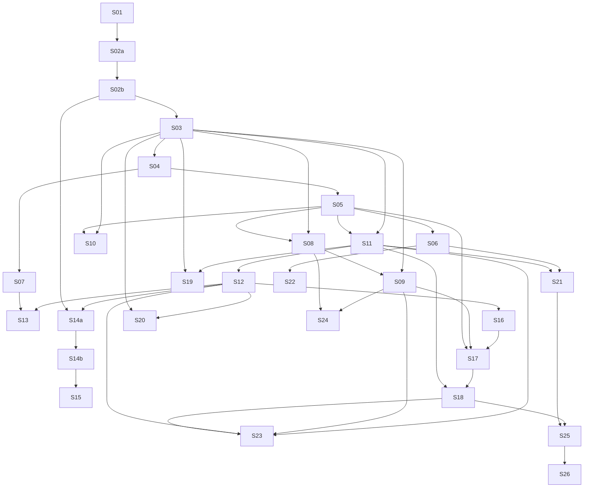

# Roadmap

The plan is organized as **vertical slices**. Every slice is runnable, demoable,
and lands with its tests; there is no orphaned scaffolding. Each slice is a
GitHub issue with a subtask checklist, and belongs to a phase milestone.

**Project board:** [alvim roadmap](https://github.com/users/josealvim/projects/1)
**Pinned tracker:** [#27 — Roadmap tracker](https://github.com/josealvim/alvim/issues/27)

- Phases: GitHub **milestones**
- Slices: GitHub **issues** (label `slice`)
- Subtasks: task-list checkboxes inside each slice issue
- Dependencies: native GitHub `blocked-by` links, mirrored in the graph below
- Areas: labels (`terminal`, `buffer`, `input`, `vim`, `ui`, `workspace`,
  `search`, `syntax`, `git`, `persistence`, `advanced`, `perf`, `docs`, ...)

The first target is a **solid single-file editor**: open, edit, undo, save,
navigate, search, and quit. Workspace, git, and advanced editing follow.

## Dependency graph

## Phase 1 — Walking skeleton

| ID | Slice | Depends on | Size | Issue |
| --- | --- | --- | --- | --- |
| S01 | Terminal driver, screen grid, event loop, headless harness | — | L | [#1](https://github.com/josealvim/alvim/issues/1) |
| S02a | Piece table and basic read-only text view | S01 | M | [#2](https://github.com/josealvim/alvim/issues/2) |
| S02b | Grapheme-correct rendering and navigation | S02a | M | [#28](https://github.com/josealvim/alvim/issues/28) |

## Phase 2 — Single-file editor

| ID | Slice | Depends on | Size | Issue |
| --- | --- | --- | --- | --- |
| S03 | Editing core: commands, insert mode, undo, atomic save, quit | S02b | L | [#3](https://github.com/josealvim/alvim/issues/3) |
| S04 | Vim motions, counts, mode transitions | S03 | M | [#4](https://github.com/josealvim/alvim/issues/4) |
| S05 | Operators, text objects, dot-repeat, registers | S04 | L | [#5](https://github.com/josealvim/alvim/issues/5) |
| S06 | Visual modes: char, line, block | S05 | M | [#6](https://github.com/josealvim/alvim/issues/6) |
| S07 | In-buffer search | S04 | M | [#7](https://github.com/josealvim/alvim/issues/7) |
| S08 | Ex command line, ranges, substitution, palette | S03, S05, S07 | M | [#8](https://github.com/josealvim/alvim/issues/8) |
| S09 | Themes, truecolor/fallback, overlays, message line | S03, S08 | M | [#9](https://github.com/josealvim/alvim/issues/9) |
| S10 | Autoindent and indentation detection | S03, S05 | S | [#10](https://github.com/josealvim/alvim/issues/10) |

## Phase 3 — Workspace

| ID | Slice | Depends on | Size | Issue |
| --- | --- | --- | --- | --- |
| S11 | Buffers, tabs, layout tree, splits | S03, S05 | L | [#11](https://github.com/josealvim/alvim/issues/11) |
| S12 | File tree with async scan and inotify refresh | S11 | L | [#12](https://github.com/josealvim/alvim/issues/12) |
| S13 | Project search with streaming results | S12, S07 | M | [#13](https://github.com/josealvim/alvim/issues/13) |
| S14a | Tree-sitter runtime, plugin ABI, C highlighting | S12, S02b | M | [#14](https://github.com/josealvim/alvim/issues/14) |
| S14b | Incremental worker-owned parsing | S14a | M | [#29](https://github.com/josealvim/alvim/issues/29) |
| S15 | Markdown, more grammars, injections, filetype detection | S14b | M | [#15](https://github.com/josealvim/alvim/issues/15) |

## Phase 4 — Git and persistence

| ID | Slice | Depends on | Size | Issue |
| --- | --- | --- | --- | --- |
| S16 | libgit2 git worker and file-tree status | S12 | M | [#16](https://github.com/josealvim/alvim/issues/16) |
| S17 | Live diff gutters against disk or HEAD | S16, S09, S05 | M | [#17](https://github.com/josealvim/alvim/issues/17) |
| S18 | Side-by-side diff view | S17, S11 | M | [#18](https://github.com/josealvim/alvim/issues/18) |
| S19 | Session restore and crash recovery | S11, S03 | M | [#19](https://github.com/josealvim/alvim/issues/19) |
| S20 | External file change detection | S12, S03 | M | [#20](https://github.com/josealvim/alvim/issues/20) |

## Phase 5 — Advanced editing and polish

| ID | Slice | Depends on | Size | Issue |
| --- | --- | --- | --- | --- |
| S21 | Multi-caret editing | S06, S11 | L | [#21](https://github.com/josealvim/alvim/issues/21) |
| S22 | Macros | S06 | M | [#22](https://github.com/josealvim/alvim/issues/22) |
| S23 | Full mouse UI | S11, S09, S12, S18 | L | [#23](https://github.com/josealvim/alvim/issues/23) |
| S24 | Completion: words, paths, commands | S09, S08 | M | [#24](https://github.com/josealvim/alvim/issues/24) |
| S25 | Performance and robustness hardening | S18, S21 | L | [#25](https://github.com/josealvim/alvim/issues/25) |
| S26 | Documentation, install, first release | S25 | M | [#26](https://github.com/josealvim/alvim/issues/26) |

## Decided defaults

- **Multi-caret keys:** `<Space>n` / `<Space>N` add next/previous occurrence,
  `Ctrl-Alt-Up/Down` stack carets, `Esc` collapses to the primary caret.
  Alt-click is added by S23. `Ctrl-D` stays vim's scroll-half-page.
- **Macros:** lettered macro registers a-z, `q{letter}` to record,
  `@{letter}` to replay, `@@` to repeat. Named yank registers remain deferred.

## Deferred

- Named yank registers
- Right-click context menus
- LSP, diagnostics, and semantic completion (the decoration layer stays
  reusable if that changes)
