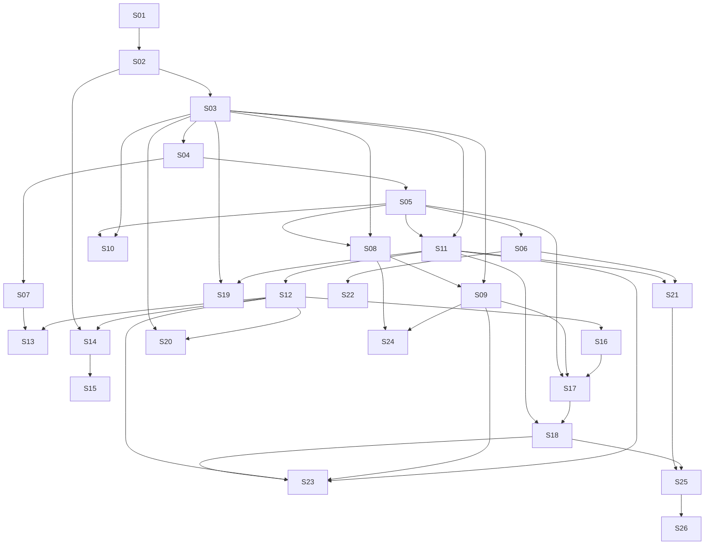

# Roadmap

The plan is organized as **vertical slices**. Every slice is runnable, demoable,
and lands with its tests; there is no orphaned scaffolding. Each slice is a
GitHub issue with a subtask checklist, and belongs to a phase milestone.

- Phases: GitHub **milestones**
- Slices: GitHub **issues** (label `slice`)
- Subtasks: task-list checkboxes inside each slice issue
- Areas: labels (`terminal`, `buffer`, `input`, `vim`, `ui`, `workspace`,
  `search`, `syntax`, `git`, `persistence`, `advanced`, `perf`, `docs`, ...)

The first target is a **solid single-file editor**: open, edit, undo, save,
navigate, search, and quit. Workspace, git, and advanced editing follow.

## Dependency graph

## Phase 1 — Walking skeleton

| ID | Slice | Depends on | Size | Issue |
| --- | --- | --- | --- | --- |
| S01 | Terminal driver, screen grid, event loop, headless harness | — | L | TBD |
| S02 | Piece table, file loading, read-only text view | S01 | L | TBD |

## Phase 2 — Single-file editor

| ID | Slice | Depends on | Size | Issue |
| --- | --- | --- | --- | --- |
| S03 | Editing core: commands, insert mode, undo, atomic save, quit | S02 | L | TBD |
| S04 | Vim motions, counts, mode transitions | S03 | M | TBD |
| S05 | Operators, text objects, dot-repeat, registers | S04 | L | TBD |
| S06 | Visual modes: char, line, block | S05 | M | TBD |
| S07 | In-buffer search | S04 | M | TBD |
| S08 | Ex command line, ranges, substitution, palette | S03, S05, S07 | M | TBD |
| S09 | Themes, truecolor/fallback, overlays, message line | S03, S08 | M | TBD |
| S10 | Autoindent and indentation detection | S03, S05 | S | TBD |

## Phase 3 — Workspace

| ID | Slice | Depends on | Size | Issue |
| --- | --- | --- | --- | --- |
| S11 | Buffers, tabs, layout tree, splits | S03, S05 | L | TBD |
| S12 | File tree with async scan and inotify refresh | S11 | L | TBD |
| S13 | Project search with streaming results | S12, S07 | M | TBD |
| S14 | Tree-sitter runtime, grammar plugin ABI, C highlighting | S12, S02 | L | TBD |
| S15 | Markdown + more grammars, injections, filetype detection | S14 | M | TBD |

## Phase 4 — Git and persistence

| ID | Slice | Depends on | Size | Issue |
| --- | --- | --- | --- | --- |
| S16 | libgit2 git worker and file-tree status | S12 | M | TBD |
| S17 | Live diff gutters against disk or HEAD | S16, S09, S05 | M | TBD |
| S18 | Side-by-side diff view | S17, S11 | M | TBD |
| S19 | Session restore and crash recovery | S11, S03 | M | TBD |
| S20 | External file change detection | S12, S03 | M | TBD |

## Phase 5 — Advanced editing and polish

| ID | Slice | Depends on | Size | Issue |
| --- | --- | --- | --- | --- |
| S21 | Multi-caret editing | S06, S11 | L | TBD |
| S22 | Macros | S06 | M | TBD |
| S23 | Full mouse UI | S11, S09, S12, S18 | L | TBD |
| S24 | Completion: words, paths, commands | S09, S08 | M | TBD |
| S25 | Performance and robustness hardening | S18, S21 | L | TBD |
| S26 | Documentation, install, first release | S25 | M | TBD |

## Deferred

- Default multi-caret keybindings (commands land first; leader-based defaults are
  the recommendation)
- Named macro registers (`q{letter}`) — v1 has one macro slot
- Right-click context menus
- LSP, diagnostics, and semantic completion remain out of scope; the decoration
  layer is designed to be reusable if that changes.
